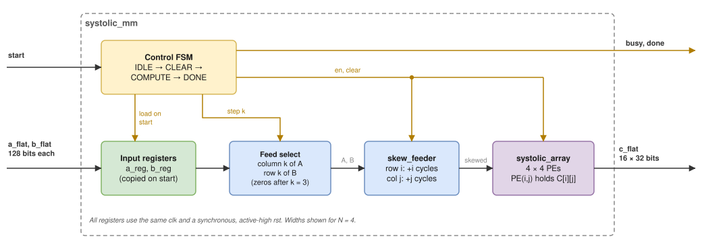
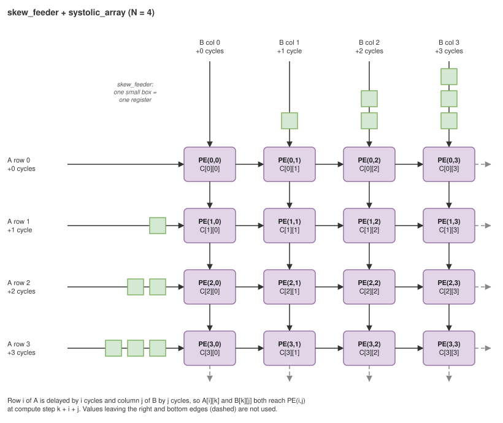
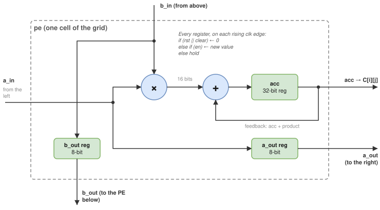
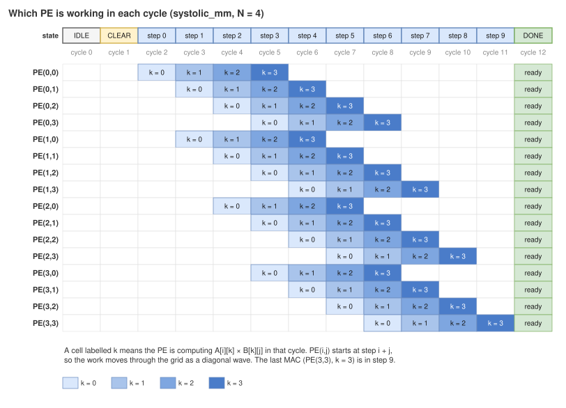
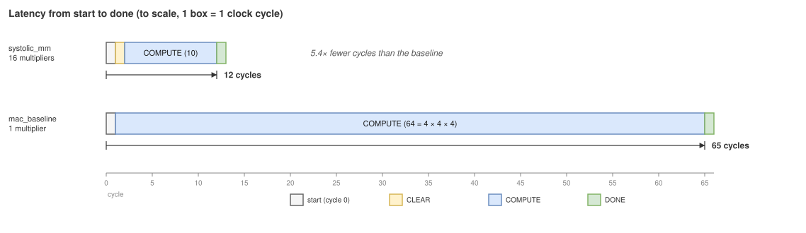
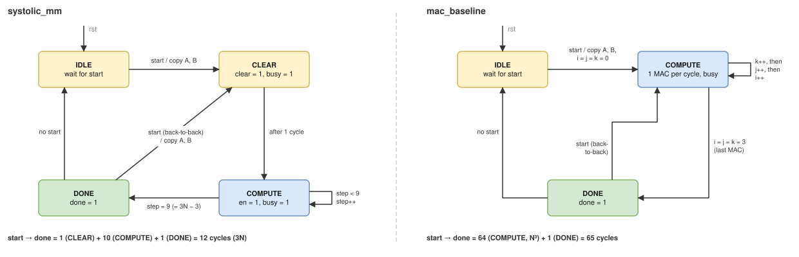
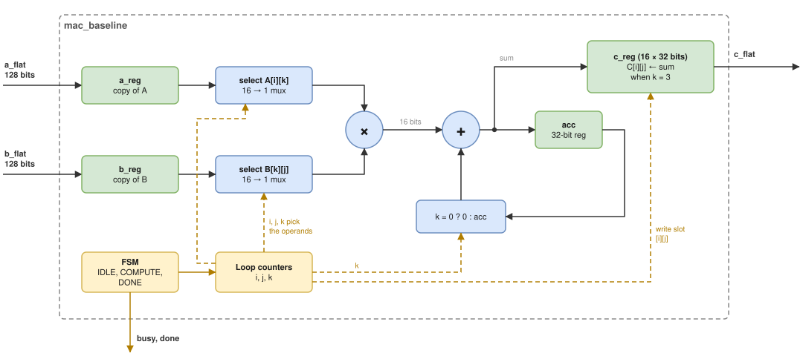
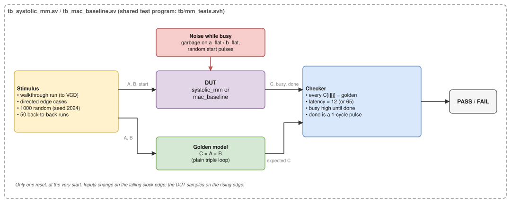

# 4×4 INT8 Systolic Array for Matrix Multiplication

A small SystemVerilog accelerator that computes **C = A × B** for 4×4 matrices
of signed 8-bit integers, using a 4×4 grid of multiply-accumulate units called
processing elements (PEs). The dataflow is **output-stationary**: PE(i,j) keeps
C[i][j] in its own 32-bit accumulator while rows of A move right and columns of
B move down, one PE per clock cycle. A skew feeder delays row *i* and column *j*
by *i* and *j* cycles, so each matching pair `A[i][k]` and `B[k][j]` meets at
the right PE at the right time. The array finishes a multiply in **12 cycles**,
compared with **65 cycles** for a baseline that has a single MAC unit (5.4×
faster). Both designs are checked by self-checking testbenches (directed edge
cases, 1000 random matrices, and back-to-back runs).

## Architecture



The FSM copies A and B into input registers on `start`. Each compute cycle it
picks one column of A and one row of B, and the skew feeder delays them into a
staircase before they enter the grid:



Each PE multiplies the two values passing through it, adds the product to its
accumulator, and passes the values on through registers:



<details>
<summary>Text version of the architecture</summary>

```
                       systolic_mm (top: FSM + A/B input registers)
   a_flat ──┐                                                   ┌── busy, done
   b_flat ──┤  IDLE → CLEAR → COMPUTE (10 cycles) → DONE        │
   start  ──┘                                                   │
                │ one column of A + one row of B per cycle      │
                ▼                                               │
        ┌──────────────── skew_feeder ────────────────┐         │
        │ row i of A delayed i cycles, col j of B j    │         │
        └──────────────────────────────────────────────┘         │
                                                                │
                 B col 0    B col 1    B col 2    B col 3       │
                 (+0)       (+1)       (+2)       (+3)          │
                   │          │          │          │           │
                   ▼          ▼          ▼          ▼           │
 A row 0 (+0) ──► PE00 ───► PE01 ───► PE02 ───► PE03            │
                   │          │          │          │           │
                   ▼          ▼          ▼          ▼           │
 A row 1 (+1) ──► PE10 ───► PE11 ───► PE12 ───► PE13            │
                   │          │          │          │           │
                   ▼          ▼          ▼          ▼           │
 A row 2 (+2) ──► PE20 ───► PE21 ───► PE22 ───► PE23            │
                   │          │          │          │           │
                   ▼          ▼          ▼          ▼           │
 A row 3 (+3) ──► PE30 ───► PE31 ───► PE32 ───► PE33            │
                                                                │
   every PE(i,j):  acc += a_in × b_in ;  a_out <= a_in ;  b_out <= b_in
   c_flat = all 16 accumulators ────────────────────────────────┘
```

</details>

## Cycle-by-cycle example (2×2)

A = [[1, 2], [3, 4]], B = [[5, 6], [7, 8]]. Expected C = [[19, 22], [43, 50]].

PE(i,j) receives `A[i][k]` and `B[k][j]` at compute step **k + i + j**. This
table comes from a simulation trace of `systolic_mm` with N = 2
(start is high in cycle 0). Each cell shows the pair being multiplied in that
cycle and, in brackets, the accumulator after the clock edge.

| Cycle | State          | PE(0,0)          | PE(0,1)          | PE(1,0)          | PE(1,1)          |
|-------|----------------|------------------|------------------|------------------|------------------|
| 0     | IDLE (start=1) | —                | —                | —                | —                |
| 1     | CLEAR          | —  [0]           | —  [0]           | —  [0]           | —  [0]           |
| 2     | COMPUTE, k=0   | a00×b00 = 1×5 [5]| —  [0]           | —  [0]           | —  [0]           |
| 3     | COMPUTE, k=1   | a01×b10 = 2×7 [19]| a00×b01 = 1×6 [6]| a10×b00 = 3×5 [15]| —  [0]          |
| 4     | COMPUTE, k=2   | —  [19]          | a01×b11 = 2×8 [22]| a11×b10 = 4×7 [43]| a10×b01 = 3×6 [18]|
| 5     | COMPUTE, k=3   | —  [19]          | —  [22]          | —  [43]          | a11×b11 = 4×8 [50]|
| 6     | DONE (done=1)  | **19**           | **22**           | **43**           | **50**           |

The "—" cells are where a PE multiplies zeros: the data hasn't reached it yet,
or has already passed. Compute takes 3N−2 = 4 cycles for N = 2, and the whole
run takes 3N = 6.

The same pattern for the full 4×4 array: each PE works for 4 cycles, starting
`i + j` cycles late, so the work sweeps through the grid as a diagonal wave.



## Results

### Latency (measured in simulation, start → done)

| Design                  | Multipliers | Latency (cycles)            | Speedup |
|-------------------------|-------------|-----------------------------|---------|
| `systolic_mm` (4×4)     | 16          | **12** = 1 CLEAR + 10 compute + 1 DONE | 5.4× |
| `mac_baseline`          | 1           | **65** = 64 compute + 1 DONE | 1×     |

The theoretical compute time is 3N − 2 = 10 cycles: PE(3,3) starts 6 cycles
late because of the skew, then needs 4 cycles. The 2 extra cycles are FSM
overhead: one to clear the accumulators, and one to present the result with
`done`. The same testbench, run with N = 2, 3 and 8, measured 6, 9 and 24
cycles (always 3N). See [docs/NOTES.md](docs/NOTES.md#step-4--top-level-and-fsm-rtlsystolic_mmsv) for details.



The two control FSMs:



The baseline uses one multiplier and two 16-to-1 multiplexers to step through
the triple loop, one multiply-accumulate per cycle:



### Verification



| Testbench             | What it checks                                                         | Result |
|-----------------------|------------------------------------------------------------------------|--------|
| `tb_pe.sv`            | reset/clear/enable priority, signed edge cases, 2000 random cycles, 32-bit accumulator width | PASS (3019 checks) |
| `tb_systolic_mm.sv`   | zeros, identity (A×I, I×B), all +127, all −128, −128×127, mixed signs, 1000 random, 50 back-to-back, exact latency | PASS (1059 runs) |
| `tb_mac_baseline.sv`  | the same tests as the systolic array                                   | PASS (1059 runs) |

There's only one reset, at the start of each simulation. While the DUT is busy,
the testbench puts random garbage on the A/B inputs and toggles `start`, to
check that the design ignores both. To check that the tests can actually fail,
7 deliberate bugs were injected (no skew, one cycle short, no input register,
no back-to-back restart, unsigned multiply, no clear, 16-bit accumulator).
All 7 were caught.

## How to run

Requirements: [Icarus Verilog](https://steveicarus.github.io/iverilog/) 11+ and GTKWave.

```bash
make test
```

Runs all three testbenches. Each one prints `PASS` or `FAIL`, and `make` stops
at the first failure.

```bash
make wave
```

Opens the first top-level run in GTKWave. The signals are preloaded from
`tb/systolic_mm.gtkw`, so you can see the staircase of A rows and B columns
entering the grid.

To try another array size (the RTL is parameterized):

```bash
iverilog -g2012 -I tb -Ptb_systolic_mm.N=8 -o build/n8.vvp rtl/pe.sv rtl/skew_feeder.sv rtl/systolic_array.sv rtl/systolic_mm.sv tb/tb_systolic_mm.sv && vvp -n build/n8.vvp
```

## Project layout

```
rtl/pe.sv              one processing element (MAC + pass-through registers)
rtl/systolic_array.sv  N×N grid of PEs (generate loops)
rtl/skew_feeder.sv     shift registers that add the i / j delays
rtl/systolic_mm.sv     top level: FSM, input registers, feeder + array
rtl/mac_baseline.sv    single-MAC reference design, same ports
tb/tb_pe.sv            PE unit test
tb/tb_systolic_mm.sv   top-level test (instantiates the DUT)
tb/tb_mac_baseline.sv  baseline test (instantiates the DUT)
tb/mm_tests.svh        shared test program: golden model + all test cases
tb/systolic_mm.gtkw    GTKWave view of the skewing
docs/NOTES.md          design notes and interview Q&A for each step
docs/figures/          architecture diagrams (.drawio.svg)
```

The diagrams in `docs/figures/` are SVG images with the draw.io source
embedded. GitHub shows them as normal images, and you can open the same file in
[diagrams.net](https://app.diagrams.net) or the VS Code *Draw.io Integration*
extension to edit them.

## Interface

| Port     | Dir | Width   | Meaning |
|----------|-----|---------|---------|
| `clk`    | in  | 1       | clock |
| `rst`    | in  | 1       | active-high synchronous reset |
| `start`  | in  | 1       | pulse to begin; A and B are captured on this edge. Ignored while busy. If high during the `done` cycle, the next run starts with no gap. |
| `a_flat` | in  | 128     | A, row-major: `A[i][k]` at bits `[(i*4+k)*8 +: 8]` |
| `b_flat` | in  | 128     | B, row-major: `B[k][j]` at bits `[(k*4+j)*8 +: 8]` |
| `busy`   | out | 1       | high while clearing and computing |
| `done`   | out | 1       | one-cycle pulse when `c_flat` is valid |
| `c_flat` | out | 512     | C, row-major: `C[i][j]` at bits `[(i*4+j)*32 +: 32]`. Holds its value until the next run clears it. |
